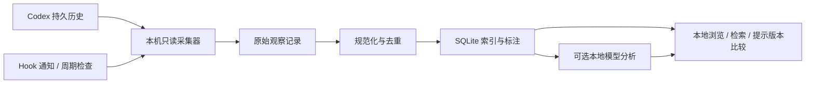

# 本地 AI 对话日志与提示词改进：方案草案

日期：2026-10-25（Asia/Shanghai）。状态：设想与调研，尚未实施采集。

## 已确认目标

- 第一入口：用户当前的 Windows Codex 桌面端。
- 核心用途：通过历史对话改进提示词。
- 数据边界：日志必须全部保存在本机；无外部服务器。
- 记录对象：用户提示、AI 可获取的输出、工具调用及结果。
- 体验目标：外部自动采集，避免让运行中的 agent 写日志或把日志重新注入上下文。
- 项目管理：本地 Markdown，默认五种 triage 标签。

本方案按日志采集、检索、复盘均在本机处理设计。若增加自动语义分析，首先考虑本地模型；调用外部模型会传出选中的日志，不属于当前边界。原有 Codex 自身的模型通信和新增日志系统是不同的数据通路。

## 产品判断

推荐做“本地对话证据库 + 提示词改进工作台”。单纯保存聊天记录无法判断提示词是否更好。应将原始提示、后续纠正、产出证据、人工结果标签关联起来，逐步形成可比较的案例。

用户提示只是结果的一个影响因素。模型版本、技能/项目指令、可见上下文、工具能力、权限、代码状态和上下文压缩都会影响结果。记录不足时应显示未知，不能把每次失败都归因于提示词。

## 一手资料与本机证据

1. [Codex Hooks 官方文档](https://learn.chatgpt.com/docs/hooks)：提供提示提交、工具执行、停止、中断等事件和异步命令 hook；异步输出仍可能进入上下文，结束时未完成 hook 可能被取消；transcript 格式不是稳定接口，部分工具路径不走通用 hook。设计含义：hook 可作通知和补充证据，不能独自承担完整归档承诺。
2. [App Server 官方文档](https://learn.chatgpt.com/docs/app-server)：提供无需恢复会话的历史读取、回合和条目分页接口；新持久会话默认使用分页历史。设计含义：先验证正式读取接口，保留旧日志适配器作为兼容路径。
3. 本机只读检查：`codex --version` 返回 `codex-cli 0.164.0-alpha.11.1`。本机生成的协议 schema 包含 `ThreadTurnsListParams`、`ThreadItemsListParams`。`itemsView` 默认 summary，full 表示持久历史中可获得的所有 ThreadItem，并不承诺模型内部全部数据。
4. 本机 schema 的事件类型覆盖 userMessage、agentMessage、commandExecution、mcpToolCall、dynamicToolCall、functionCallOutput、collabAgentToolCall、subAgentActivity、webSearch、fileChange、contextCompaction 等。这里只验证接口定义，没有连接运行中的桌面 daemon，也没有读取私人会话或验证实际覆盖率。
5. [GitHub 候选调研](github-candidates.md)：已有本地查看器可复用，但当前输入主要依赖旧 rollout JSONL，必须验证版本适配。

上述事实不等同于采集器已经可用。尤其要验证当前桌面端连接方式、可见会话范围、分页项的完整程度，以及代码执行器内部的嵌套工具是否有独立事件。

## 推荐架构

### 采集：先留证，再分析

优先顺序是能力验证后确定的：历史读取 API → hook 补充和通知 → 兼容的原生文件适配器。不要提前锁定所有桌面会话都存在 JSONL，也不要直接写 Codex 内部数据库。

采集器增量读取已变化会话；回合结束提示可缩短延迟，定时对账负责漏通知和离线恢复。正在运行的条目可能由进行中变为完成，因此不能仅使用“读到末尾后永不回看”的策略。应回查最近活动回合，保留条目状态修订。

Hook 只承担小型本地任务：保存最小事件或投递通知，按事件要求正常返回，不输出上下文、纠错反馈或继续执行要求。可靠性与延迟存在取舍：同步轻量落盘要测耗时，纯异步通知要允许丢失并能从历史补回。任一方式都有 CPU/I/O 开销，目标是无额外模型调用、无日志上下文注入和可测的低开销。

### 数据：原始记录与检索索引分开

个人首版建议一个本地数据目录和 SQLite，文本索引先做全文/关键词搜索。中文检索要验证分词或子串策略，不能默认英文 tokenizer 能满足需求。大量工具输出和图片等附件存独立文件，索引保存引用与哈希。界面可用 localhost 网页，不需要外部服务器。

保存“数据源实际提供的原始 JSON/文件”，注明是 API 快照还是原生日志。规范化表和摘要可以重建，不能用 AI 摘要替代证据。原始记录采用追加修订；去重依据来源实例、thread、turn、item/call ID 及修订标识，不用文本内容去重，否则重复发出的同一句提示会被误删。

本地目录应在源码仓库之外，避免未来提交代码时带上日志。原文与用于展示/导出的脱敏副本分开，删除时同时清理索引、附件、摘要及备份中的对应记录。首版默认不启用候选软件的云端改写、遥测上传或同步功能，需实际核查其联网行为。

### 最小数据模型

| 对象 | 关键字段 | 用途 |
| --- | --- | --- |
| 会话/分支 | source_instance、thread_id、session_id、parent_thread_id、fork 来源、项目 | 避免混淆主会话、子 agent 与分叉 |
| 回合 | turn_id、状态、开始/结束时间、模型与可获取配置 | 关联提示和结果；区分完成、中断、失败、未知 |
| 事件/条目 | source_item_id、类型、角色/phase、call_id、父调用、源顺序、源时间、采集时间 | 还原因果关系，避免按异步到达顺序误排序 |
| 内容 | 提示原文、回答、工具名/参数/结果、退出状态、原始引用 | 从诊断返回原始证据 |
| 完整性 | complete/partial/unknown、截断信息、缺失原因、来源版本 | 不把缺记录误判成没发生 |
| 反馈 | 满意/需修改/不可用、原因标签、对应事件 | 建立提示词质量信号 |
| 提示版本 | 原始文本、归一化模板、版本关系、改动说明、适用任务 | 比较提示变化而非覆盖原提示 |
| 分析建议 | 引用事件、假设、建议、分析器版本、人工采纳状态 | 区分事实、推断和已验证改进 |

时间、耗时、token 和错误状态缺失时使用 null/unknown，不制造精度。一个工具返回进程句柄不代表后台工作已完成，需关联后续轮询和退出。

### “记录所有”的实际边界

首版承诺目标应是“保留当前数据源可访问的消息和执行证据，并显式标出缺失”。不能承诺获取隐藏思维链、未暴露的完整系统提示、已截断的原始命令输出或已删除的远端附件。

用户聊天原文不等于每次模型请求的完整输入。后续纠正、环境上下文、工具反馈、压缩摘要可能改变模型实际可见信息。若某项没有可靠接口，就记录不可得；不要推测后当作事实。

“历史查看”也不等于“重新执行”。首版不自动重放命令或有副作用工具。提示实验应使用独立样本及隔离工作区，控制模型/工具/输入条件。

## 提示词改进闭环

1. 自动保存完整可得记录。
2. 用户遇到问题时做一次轻量标注：不满意的输出 + 原因，或标记一次满意结果。
3. 将后续补充提示关联到其修正的原要求。例如“不要改其他文件”可以标成范围补充，但不能仅凭这句话断言上一轮违规。
4. 从多次案例中寻找重复遗漏：范围、输入材料、交付格式、成功标准、验证方式。
5. 生成最小改动的候选提示，逐条链接证据，由用户采纳。
6. 在相近任务中比较一次达标率、人工纠正次数、约束遵守情况和验证结果。耗时/token 仅作辅助；更短的对话不必然更好。

建议保留四类归因：提示表达、可见信息、工具/环境、执行行为。自动分类只能产生待确认假设。

第一版可以完全不用模型：检索、标注、版本对比已经有价值。若本机有适合的模型，再增加异步分析。真实 Codex 新实验本身会走其现有服务，不属于日志系统的本地分析；不能以“本地保存”为由宣称实验也完全离线。

## 第一版范围与验收

### 第一步：采集可行性验证

用无敏感的受控样本验证成功工具、失败工具、长输出、中途取消、子 agent、后台任务、多轮提示和上下文压缩。检查提示/回答原文、工具参数结果、调用配对、父子关系，以及哪些内容被截断。覆盖率分母以样本预期事件和可观察界面交叉确认，不以采集结果自己证明自己。

停止采集器再恢复，重复导入同一会话，检查漏记、重复、进行中状态更新及分页边界。对比有无采集时的耗时和资源使用；阈值由实测后确定，不预先声称零开销。

### 第二步：验证复用路径

优先比较 AgentXRay 与 Sessions Viewer。只有样本读取完整性通过后才判断是否可直接使用。若缺的是格式适配，补适配层；若缺的是提示标注/比较，补分析层。不要因界面看得到聊天就认定所有工具输出已保存。

### 第三步：最小工作流

实现项目/会话筛选、提示与工具结果检索、回合时间线、满意度和原因标注、提示版本对比、原始记录导出。首版先单用户、单机、单平台；不引入多租户、分布式队列或向量数据库。

### 第四步：积累真实改进样本

建议先积累约 20 个带人工结果标注的案例（这是产品试验建议，不是统计显著性保证）。判断能否发现重复问题、是否减少人工纠正，再决定本地自动总结或更复杂评估是否值得投入。

## 待确认的产品问题

- 优先改善哪类提示：编程、资料研究、文档/内容制作，还是其他？
- 用户愿意在哪个时刻标注一次结果：每轮结束、明显出错时，还是每周集中复盘？
- 本地自动语义分析是否有硬件条件？没有也可先完成无模型版本。
- 保留多久原始记录，是否需本地加密、离线备份和跨设备迁移？

当前最小下一步是采集可行性验证，而不是直接搭建完整日志平台。
